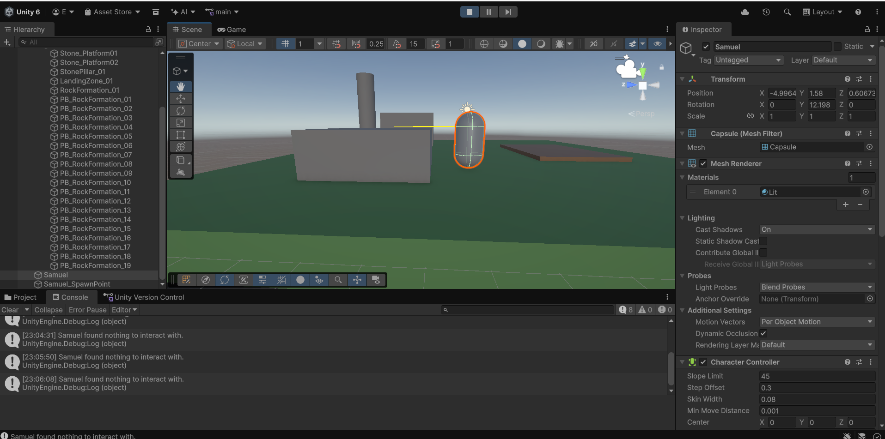
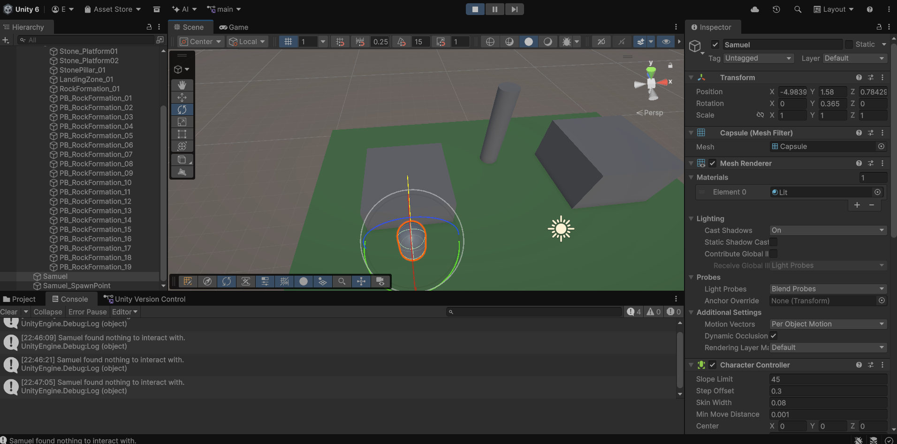
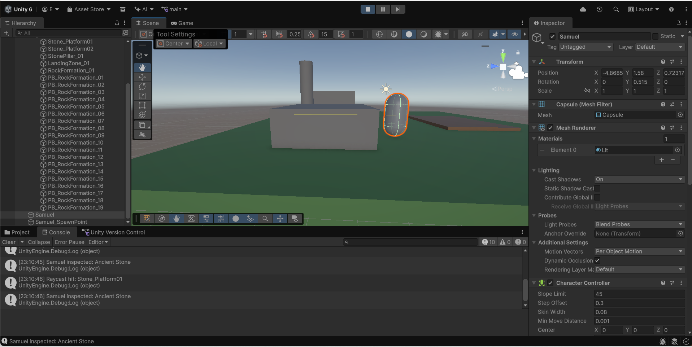

# QA Engineering Portfolio

Welcome! I'm Edward Stevens Jr., an aspiring QA Engineer based in Las Vegas, Nevada. I completed TripleTen's Quality Assurance Engineering program and have hands-on training in manual testing, API testing, mobile testing, and defect reporting.

## Technical Skills
- Testing: Functional, Regression, Smoke, Manual, Mobile, Boundary Value Analysis, Equivalence Partitioning
- Tools: Jira, Postman, Chrome DevTools, Android Studio, SQL, Git/GitHub
- Additional: Python, Selenium, Unity, C# (in development)

## Portfolio Projects

### Ascension — Gameplay Quality Assurance

An independent third-person Unity game project where I develop gameplay systems and test movement, jumping, gravity, camera controls, collision behavior, and object interactions.

**QA Focus:**
- Manual and functional testing
- Test case design and execution
- Raycast interaction troubleshooting
- Defect investigation and reporting
- Fix verification

**QA Documentation:**
- [Interaction System Test Cases](test-cases.md)
- [Bug Report — Ancient Stone Interaction Failure](bug-report.md)

**Testing Evidence:**

**1. Initial Interaction Failure**

**2. Raycast Investigation**

**3. Successful Interaction Verification**

**Test Result:** PASS — The interaction system successfully detected `Stone_Platform01` and executed the Ancient Stone interaction, confirmed through Unity Console messages.

The game source code remains private. This portfolio contains selected QA documentation and testing evidence.

### Steam — Web Testing

An independent project exploring web testing and automation for Steam's website. Test artifacts will be linked after review.

### TripleTen — QA Training Projects

Training experience involving web, mobile, and API testing. Verified, shareable test artifacts will be added when available.

## Contact
- LinkedIn: https://www.linkedin.com/in/edward-stevens-jr/
- GitHub: https://github.com/eddiestevens27-del

Enjoy!
