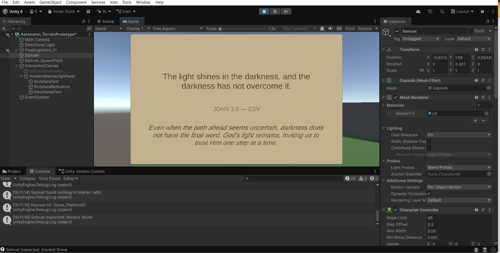

# Ascension — Interaction System Test Cases

**Environment:** Unity 6, Windows, Ascension Terrain Prototype

| Test ID | Test Scenario | Expected Result | Status |
|---|---|---|---|
| TC-001 | Press E while facing Ancient Stone in successful test configuration | Interaction executes | PASS |
| TC-002 | Raycast intersects Stone_Platform01 | Console identifies collider | PASS |
| TC-003 | InteractableObject component receives interaction | Console displays inspection message | PASS |
| TC-004 | Press E outside interaction range | No interaction occurs | NOT RUN |
| TC-005 | Press E while facing away from stone | No interaction occurs | NOT RUN |
| TC-006 | Place another collider between Samuel and the stone | Interaction does not pass through obstruction | NOT RUN |
| TC-007 | Restore interaction range to 3 units and retest | Interaction succeeds within intended range | NOT RUN |

## Test Execution Summary

**Executed:** 3

**Passed:** 3

**Failed:** 0

**Not Run:** 4

## Notes
The successful interaction path was verified using Unity Console messages. Negative testing, obstruction testing, and final interaction-range verification remain outstanding.

## Ancient Manuscript Interaction

### Test Environment
- Application: Ascension
- Engine: Unity 6
- Platform: Windows
- Test Type: Manual Functional Testing
- Environment: Unity Editor — Play Mode

### Test Cases

| Test ID | Scenario | Test Steps | Expected Result | Actual Result | Status |
|---|---|---|---|---|---|
| AM-001 | Initial UI state | Enter Play Mode | Manuscript remains hidden | Manuscript hidden | PASS |
| AM-002 | Interaction detection | Approach and face Ancient Stone | Interaction prompt appears | Prompt displayed | PASS |
| AM-003 | Open manuscript | Press E while targeting the stone | Scripture and devotional appear | Manuscript displayed | PASS |
| AM-004 | Prompt visibility | Observe UI while reading | Interaction prompt remains hidden | Prompt hidden | PASS |
| AM-005 | Repeated input | Press E while manuscript is open | No additional interaction occurs | No repeated interaction | PASS |
| AM-006 | Close manuscript | Press ESC | Manuscript closes | Manuscript closed | PASS |
| AM-007 | Reopen manuscript | Press E while targeting the stone again | Manuscript reopens | Manuscript reopened | PASS |
| AM-008 | Out-of-range interaction | Close manuscript, move out of range and press E | Manuscript remains closed | Manuscript remained closed | PASS |
| AM-009 | Console verification | Review Console after test execution | No new errors or warnings | Zero errors and warnings | PASS |

### Test Execution Summary
- Total executed: 9
- Passed: 9
- Failed: 0
- Pass rate: 100%

### Test Evidence

### Known Limitations
- Movement and camera controls remain enabled while reading.
- Interactable objects currently share the same manuscript content.
- Broader gameplay regression testing is pending.
